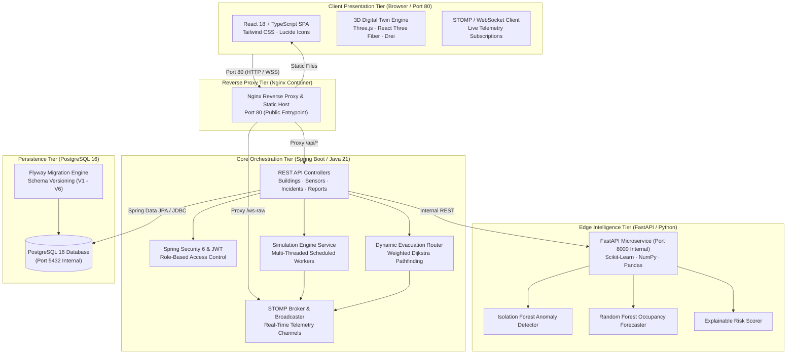

# NEXORA — Edge-AI-Based Smart Building Safety and Occupancy Digital Twin System

> **Tagline:** *Intelligence Beyond Infrastructure.*  
> An enterprise-grade, microservice-powered smart building intelligence platform combining high-throughput virtual IoT sensor simulation, local sub-50ms edge machine learning, browser-native 3D digital twins, and dynamic hazard-avoidance evacuation routing.

---

## 1. Executive Summary

**NEXORA** is a software engineering capstone platform that bridges physical facility operations, edge artificial intelligence, interactive WebGL 3D digital twins, and automated life-safety incident response. 

The system simulates a commercial facility with multi-modal virtual IoT sensors, streams high-frequency telemetry into a Java 21 Spring Boot core, executes localized sub-50ms machine learning inference via a Python FastAPI microservice, persists relational records in PostgreSQL across six Flyway schema migrations, and projects the facility into an interactive 3D digital twin rendered directly in the web browser.

> **Academic & Simulation Disclaimer:** NEXORA is an academic engineering capstone prototype. All virtual IoT sensors, environmental metrics, crowd fluctuations, and evacuation progress counters are simulated algorithmically in software. Machine learning models were calibrated on synthetic physical baselines (ASHRAE/EPA standards). The system is not physically connected to building hardware and is not certified under NFPA 72 or UL 864 standards for physical fire alarm dispatch.

---

## 2. Key Capabilities & Functional Pillars

1. **Role-Based Access Control & Topology:**
   - Hierarchical structural models: Building $\to$ Floor $\to$ Room with 3D spatial bounding volumes `(x, y, z, width, depth, height)`.
   - Four distinct user tiers: `SYSTEM_ADMIN`, `BUILDING_MANAGER`, `SAFETY_OFFICER`, and `OCCUPANT`.
2. **Virtual IoT Fleet Simulation:**
   - High-throughput scheduled background worker pools simulating 5 sensor categories: Temperature (°C), Humidity (%), Smoke Ionization (ppm), Air Quality (AQI), and Occupancy (Count).
   - Injectable operational scenarios: Normal Ambient Drift, Heatwave / Thermal Spike, Fire Hazard / Smoke Event, Crowd Surge, and Sensor Degradation.
3. **Edge AI Intelligence Microservice:**
   - **Isolation Forest Anomaly Detector:** Unsupervised multi-modal anomaly scoring with contributing feature explanations.
   - **Random Forest Occupancy Forecaster:** 100-tree ensemble predicting 15-minute future occupant density and space utilization.
   - **Explainable Multi-Criteria Risk Engine:** Weighted composite safety scoring ($0 - 100$) with non-linear critical hazard overrides (Smoke $\ge 10\text{ ppm}$ or Temp $\ge 55^\circ\text{C}$).
4. **Interactive 3D Building Digital Twin:**
   - Browser-native WebGL rendering using Three.js and React Three Fiber.
   - Interactive spatial orbit navigation, camera view presets (`TOP`, `FRONT`, `SIDE`, `RESET`), and real-time vertical floor separation slider ($0\text{m} - 15\text{m}$).
   - Dynamic visual heatmaps for safety threat level, crowd utilization, and environmental metrics.
5. **Emergency Operations Center & Dynamic Evacuation:**
   - Full incident lifecycle tracking: `DETECTED` $\to$ `ACKNOWLEDGED` $\to$ `RESPONDING` $\to$ `RESOLVED` $\to$ `CLOSED`.
   - Weighted Dijkstra pathfinding navigating occupants to nearest safe exterior exits while applying heavy detour penalties (+50m) to high-hazard zones and severing compromised paths.
   - Interactive corridor blockade toggling with sub-5ms dynamic path recalculation broadcast live over WebSockets.
6. **Analytics, Post-Mortem Studio & Management Reports:**
   - Multi-series historical telemetry queries and interactive Recharts visualizations.
   - Automated Incident Post-Mortem drafting with AI narrative generation, timeline construction, and root-cause assessment.
   - Direct streaming PDF executive incident report generation.

---

## 3. System Architecture



---

## 4. Technology Stack Matrix

| Layer | Technologies & Frameworks | Version / Runtime | Purpose |
| :--- | :--- | :--- | :--- |
| **Frontend Core** | React, TypeScript, Vite, Tailwind CSS | React 18.3, TS 5.6 | Single Page Application UI & State Management |
| **3D Digital Twin** | Three.js, React Three Fiber, Drei | Three 0.169, R3F 8.17 | WebGL interactive 3D spatial building twin |
| **Data Visuals** | Recharts, Lucide Icons | Recharts 3.10 | Telemetry line/bar charts and SVG iconography |
| **Backend Core** | Java 21 LTS, Spring Boot, Maven | Boot 3.3.5, Javac 21 | Core business orchestration, security & REST APIs |
| **Security** | Spring Security 6, JJWT, BCrypt | JJWT 0.12.6 | Stateless JWT authorization & password hashing |
| **Real-Time** | Spring WebSocket, STOMP, SockJS | STOMP 1.2 over WS | Bi-directional streaming telemetry and alert push |
| **Edge AI Engine** | Python, FastAPI, Uvicorn, Scikit-Learn | Python 3.11, Scikit 1.6| Sub-50ms local machine learning microservice |
| **Database** | PostgreSQL Alpine, Flyway, HikariCP | PG 16, Flyway 10 | Relational data persistence & versioned schema |
| **Reverse Proxy** | Nginx Alpine | Nginx 1.25 | Gzip compression, security headers & reverse proxy |
| **Containerization**| Docker, Docker Compose | Compose Spec 3.8 | Multi-container orchestration & isolated networking|

---

## 5. Quickstart Deployment Guide (Docker Compose)

### 1. Clone the Repository
```bash
git clone https://github.com/tharunsai2307/NEXORA.git
cd NEXORA
```

### 2. Configure Environment Variables
```bash
cp .env.example .env
```
*(On Windows PowerShell, use `Copy-Item .env.example .env`)*

### 3. Start Application
```bash
docker compose up -d --build
```

### 4. Access the Dashboard
Open your web browser and navigate to:
```
http://localhost (or http://localhost:80)
```

---

## 6. Preconfigured Demo User Accounts

NEXORA comes seeded with four preconfigured accounts matching each RBAC persona:

| Persona | Email Address | Password | Primary Accessible Modules |
| :--- | :--- | :--- | :--- |
| **System Administrator** | `admin@nexora.com` | `Admin@123` | Full Access: User RBAC, Topologies, Model Retrain, Post-Mortems |
| **Building Manager** | `manager@nexora.com` | `Manager@123` | Fleet Management, Sensors, Simulations, Analytics & Reports |
| **Safety Officer** | `safety@nexora.com` | `Safety@123` | Emergency Operations Center, Dijkstra Routing, Corridor Blockades |
| **Building Occupant** | `occupant@nexora.com` | `Occupant@123` | 3D Twin Viewer, Active Evacuation Routes, Profile |

*Tip: Use the one-click **"Select Preconfigured Demo Role"** buttons on the login screen for instant authentication.*

---

## 7. Technical Documentation Sitemap

Detailed specifications and architectural guides are maintained in the [`docs/`](./docs) directory:

- [**System Architecture & ADRs**](./docs/architecture/architecture.md): C4 system models, component specifications, deployment topology, and ADR records.
- [**UML Diagrams (OOAD)**](./docs/uml/UML_DIAGRAMS.md): UML Use Case, Domain Class Diagram, 3 Sequence Diagrams, and Emergency Activity Diagram.
- [**Database Schema & Migrations**](./docs/DATABASE_SCHEMA.md): Complete Mermaid ER diagram and Flyway migration ledger (V1 through V6).
- [**REST API & WebSocket Documentation**](./docs/API_DOCUMENTATION.md): Complete catalog of REST endpoints and STOMP topic channels.
- [**Edge AI Methodology**](./docs/AI_METHODOLOGY.md): Isolation Forest, Random Forest, explainable risk algorithms, inputs, outputs, and metrics.
- [**Simulation & Evacuation Routing**](./docs/SIMULATION_AND_EVACUATION.md): Virtual sensor physics, scenario injection, and weighted Dijkstra pathfinding.
- [**Installation & Operations Guide**](./docs/INSTALLATION.md): Comprehensive Docker Compose and standalone local setup instructions.
- [**User & Administrator Manual**](./docs/USER_GUIDE.md): Feature tours, RBAC matrix, and operational walkthroughs.
- [**Troubleshooting Runbook**](./docs/TROUBLESHOOTING.md): Health checks, port conflict fixes, WebGL recovery, and log inspection.
- [**Limitations & Future Scope**](./docs/LIMITATIONS.md): Transparent documentation of simulation boundaries and future roadmap.
- [**Capstone Presentation Outline**](./docs/PRESENTATION.md): Exactly 6 defense slides covering problems, architecture, AI, and evacuation.
- [**Phase 9 Deployment Report**](./docs/PHASE_9_REPORT.md): Final deployment verification and handoff summary.

---

## 8. License & Academic Attribution

This project is submitted as an academic software engineering capstone project under the title:  
**Edge-AI-Based Smart Building Safety and Occupancy Digital Twin System**.
