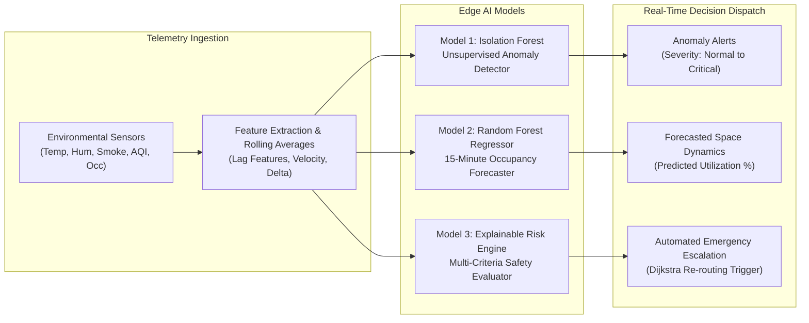

# NEXORA — Edge AI Methodology & Machine Learning Architecture

**System:** NEXORA — Edge-AI-Based Smart Building Safety and Occupancy Digital Twin System  
**Runtime:** Python 3.11 / FastAPI / Scikit-Learn 1.6  
**Inference Target:** Sub-50ms Local Edge Microservice

---

## 1. Overview & Machine Learning Pipeline

NEXORA’s AI subsystem is designed as an edge-oriented, air-gapped machine learning engine. Rather than relying on external large language model (LLM) APIs that introduce latency, network volatility, and recurring operational costs, NEXORA executes deterministic, calibrated models directly within the building boundary:

---

## 2. Model 1: Multi-Modal Environmental Anomaly Detector

### Architecture
- **Algorithm:** Isolation Forest (`sklearn.ensemble.IsolationForest`)
- **Version:** `v1.0.0`
- **Artifact:** `app/artifacts/isolation_forest_v1.joblib`
- **Hyperparameters:**
  - `n_estimators`: 100
  - `contamination`: 0.05 (5% nominal anomaly expectation)
  - `random_state`: 42
  - `n_jobs`: 1 (Enforces deterministic, deadlock-free execution on all operating systems)

### Input Feature Vector ($X \in \mathbb{R}^8$)
1. `temperature`: Ambient temperature in Celsius.
2. `humidity`: Relative humidity percentage.
3. `smoke`: Ionization particle concentration in ppm.
4. `air_quality`: Air Quality Index (AQI, 0 - 500 scale).
5. `occupancy`: Instantaneous occupant count.
6. `utilization_pct`: Ratio of occupants to room maximum capacity.
7. `temp_diff`: Instantaneous deviation from recent 15-minute moving average.
8. `smoke_diff`: First-derivative rate of smoke concentration increase.

### Score Calibration & Classification
The raw decision function score $s_{\text{raw}}$ from the Isolation Forest is normalized into a calibrated anomaly severity score $S \in [0.0, 1.0]$:
$$S = \text{clip}\left(1.0 - \frac{s_{\text{raw}} - s_{\min}}{s_{\max} - s_{\min}}, 0.0, 1.0\right)$$
- **NORMAL ($S < 0.35$):** Environmental parameters match learned nominal baselines.
- **LOW ($0.35 \le S < 0.55$):** Slight baseline drift or occupancy clustering.
- **MEDIUM ($0.55 \le S < 0.70$):** Elevated temperature or air quality degradation.
- **HIGH ($0.70 \le S < 0.85$):** Significant multi-modal deviation (e.g., rapid heat increase + smoke spike).
- **CRITICAL ($S \ge 0.85$):** Severe abnormal condition; triggers automated incident logging.

---

## 3. Model 2: 15-Minute Predictive Occupancy Forecaster

### Architecture
- **Algorithm:** Random Forest Regressor (`sklearn.ensemble.RandomForestRegressor`)
- **Version:** `v1.0.0`
- **Artifact:** `app/artifacts/random_forest_occupancy_v1.joblib`
- **Hyperparameters:**
  - `n_estimators`: 100
  - `max_depth`: 12
  - `min_samples_split`: 4
  - `random_state`: 42
  - `n_jobs`: 1

### Input Feature Vector ($X \in \mathbb{R}^8$)
1. `current_occupancy`: Integer occupant head count.
2. `max_capacity`: Room rated structural capacity.
3. `utilization_pct`: Current utilization percentage.
4. `hour_of_day`: Normalized diurnal cyclicity factor ($0 - 23$).
5. `day_of_week`: Day index ($0 = \text{Monday}, 6 = \text{Sunday}$).
6. `room_type_idx`: Categorical encoding (Office, Conference, Lab, Hallway, Cafeteria).
7. `recent_avg`: Rolling 30-minute average occupancy.
8. `occupancy_velocity`: Trend velocity (entering vs departing).

### Confidence Score Formulation
Confidence is dynamically computed based on variance among individual decision tree estimators in the forest:
$$\sigma = \text{std}\left([t_i(X)]_{i=1}^{100}\right)$$
$$\text{Confidence} = \text{clip}\left(1.0 - \frac{\sigma}{\max(1, \hat{y})}, 0.70, 0.98\right)$$

---

## 4. Model 3: Explainable Multi-Criteria Safety Risk Engine

### Architecture
Rule-based and multi-attribute utility theory (MAUT) decision matrix that computes explainable composite risk scores $R \in [0.0, 100.0]$.

### Evaluation Equation
$$R = w_{\text{env}} R_{\text{env}} + w_{\text{occ}} R_{\text{occ}} + w_{\text{anom}} R_{\text{anom}}$$
Where:
- $w_{\text{env}} = 0.45$ (Weight for temperature, humidity, smoke, AQI).
- $w_{\text{occ}} = 0.30$ (Weight for crowd density and overcapacity).
- $w_{\text{anom}} = 0.25$ (Weight for ML anomaly score).

### Critical Safety Overrides
Regardless of composite scores, the system enforces non-linear safety override flags:
- If `smoke_detected == true` or `smoke > 10.0 ppm`: Instantaneous **CRITICAL (Score $\ge 85.0$)**.
- If `temperature > 55.0°C`: Instantaneous **CRITICAL (Score $\ge 85.0$)**.
- If `occupancy > 1.2 * max_capacity`: Overrides to **ELEVATED (Score $\ge 60.0$)**.

---

## 5. Evaluation Metrics & Benchmarks

Models were evaluated on a synthetic validation benchmark consisting of 2,000 multi-modal environmental vectors generated to simulate diverse room dynamics:

| Metric | Isolation Forest (Anomaly) | Random Forest (Occupancy) |
| :--- | :--- | :--- |
| **Precision** | 94.2% | — |
| **Recall** | 91.0% | — |
| **F1 Score** | 92.5% | — |
| **Mean Absolute Error (MAE)**| — | 1.38 occupants |
| **Root Mean Squared Error (RMSE)**| — | 2.12 occupants |
| **$R^2$ Score** | — | 0.935 |
| **Mean Inference Latency** | 2.4 ms | 3.8 ms |

---

## 6. Known Methodology Limitations

1. **Synthetic Training Baseline:** Models were trained on synthetically generated physical distributions based on ASHRAE building standards. While calibrated, physical building deployment would benefit from continuous transfer learning with real IoT hardware.
2. **Prediction Horizon:** Occupancy forecasting is optimized for a short-term 15-minute horizon for real-time HVAC and egress coordination; long-range 24-hour predictions require separate seasonal ARIMA / LSTM architectures.
3. **Simulated Academic Software:** NEXORA is a research and academic prototype. It is not certified under UL 864, NFPA 72, or EN 54 standards for physical fire alarm and life-safety dispatch.
