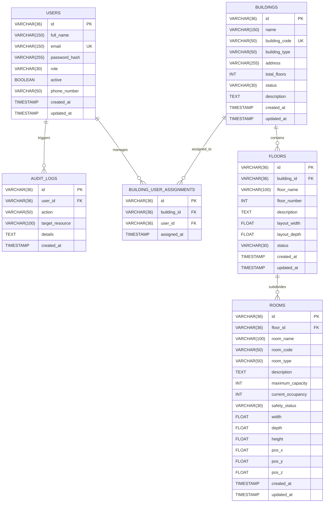

# NEXORA — Relational Database Schema & Data Architecture (PostgreSQL)

## 1. Overview
NEXORA utilizes **PostgreSQL** as its enterprise relational store, managed via **Flyway** schema migrations. All persistent data is accessed exclusively through the Java Spring Boot backend using Spring Data JPA / Hibernate. Direct access from the Python AI service or frontend is architecturally forbidden.

---

## 2. Entity-Relationship Diagram (ERD)



---

## 3. Relational Table Specifications

### 3.1 `users`
Stores user identities, credentials, and access roles.
- `id` (VARCHAR(36), PK): UUID.
- `full_name` (VARCHAR(150), NOT NULL): Legal name.
- `email` (VARCHAR(150), UNIQUE, NOT NULL): Canonical login identity.
- `password_hash` (VARCHAR(255), NOT NULL): BCrypt salted hash.
- `role` (VARCHAR(30), NOT NULL): Enum (`SYSTEM_ADMIN`, `BUILDING_MANAGER`, `SAFETY_OFFICER`).
- `active` (BOOLEAN, NOT NULL, DEFAULT true): Account activation flag.
- `phone_number` (VARCHAR(50)): Optional emergency contact phone.
- `created_at`, `updated_at` (TIMESTAMP WITH TIME ZONE, NOT NULL).

### 3.2 `buildings`
Physical structures monitored by the digital twin.
- `id` (VARCHAR(36), PK): UUID.
- `name` (VARCHAR(150), NOT NULL): Facility display name.
- `building_code` (VARCHAR(50), UNIQUE, NOT NULL): E.g. `NEX-TWR-01`.
- `building_type` (VARCHAR(50), NOT NULL): Enum (`COMMERCIAL`, `EDUCATIONAL`, etc.).
- `address` (VARCHAR(255), NOT NULL): Physical address.
- `total_floors` (INT, DEFAULT 1): Number of vertical floors.
- `status` (VARCHAR(30), NOT NULL): Enum (`ACTIVE`, `MAINTENANCE`, `INACTIVE`, `EMERGENCY`).
- `description` (TEXT): Overview and building characteristics.

### 3.3 `floors`
Horizontal slices within a building.
- `id` (VARCHAR(36), PK): UUID.
- `building_id` (VARCHAR(36), FK -> `buildings.id`, ON DELETE CASCADE).
- `floor_name` (VARCHAR(100), NOT NULL): E.g., "Ground Lobby".
- `floor_number` (INT, NOT NULL): E.g., 0, 1, 2. (Unique per `building_id`).
- `layout_width` (DOUBLE PRECISION, NOT NULL): Footprint width in meters ($m$).
- `layout_depth` (DOUBLE PRECISION, NOT NULL): Footprint depth in meters ($m$).
- `status` (VARCHAR(30), NOT NULL): Enum (`ACTIVE`, `RESTRICTED`, etc.).

### 3.4 `rooms`
3D spatial bounding volumes and functional rooms.
- `id` (VARCHAR(36), PK): UUID.
- `floor_id` (VARCHAR(36), FK -> `floors.id`, ON DELETE CASCADE).
- `room_name` (VARCHAR(100), NOT NULL): E.g., "Command Center".
- `room_code` (VARCHAR(50), NOT NULL): E.g., "101-CMD". (Unique per `floor_id`).
- `room_type` (VARCHAR(50), NOT NULL): Classification enum.
- `maximum_capacity` (INT, NOT NULL, DEFAULT 10): Max headcount limit.
- `current_occupancy` (INT, NOT NULL, DEFAULT 0): Live headcount.
- `safety_status` (VARCHAR(30), NOT NULL, DEFAULT 'NORMAL'): Safety status.
- `width` (DOUBLE PRECISION, NOT NULL, DEFAULT 10.0): Spatial width ($\Delta X$).
- `depth` (DOUBLE PRECISION, NOT NULL, DEFAULT 8.0): Spatial depth ($\Delta Z$).
- `height` (DOUBLE PRECISION, NOT NULL, DEFAULT 3.5): Ceiling height ($\Delta Y$).
- `pos_x`, `pos_y`, `pos_z` (DOUBLE PRECISION, NOT NULL, DEFAULT 0.0): 3D coordinates.

### 3.5 `building_user_assignments`
Maps building managers to their authorized facilities.
- `id` (VARCHAR(36), PK): UUID.
- `building_id` (VARCHAR(36), FK -> `buildings.id`, ON DELETE CASCADE).
- `user_id` (VARCHAR(36), FK -> `users.id`, ON DELETE CASCADE).
- `assigned_at` (TIMESTAMP WITH TIME ZONE, NOT NULL).
- Constraint: `UNIQUE(building_id, user_id)`.

---

## 4. Performance Indexes

```sql
CREATE INDEX idx_users_email ON users(email);
CREATE INDEX idx_users_role ON users(role);
CREATE INDEX idx_buildings_code ON buildings(building_code);
CREATE INDEX idx_floors_building ON floors(building_id);
CREATE INDEX idx_rooms_floor ON rooms(floor_id);
CREATE INDEX idx_rooms_safety_status ON rooms(safety_status);
CREATE INDEX idx_building_user_assignments_bld ON building_user_assignments(building_id);
CREATE INDEX idx_building_user_assignments_usr ON building_user_assignments(user_id);
CREATE INDEX idx_audit_logs_user ON audit_logs(user_id);
```

---

## 5. Seeded Baseline Data

Migration `V2__auth_and_building_management.sql` establishes initial default accounts and topology:

1. **System Administrator:** `admin@nexora.com` / `NexoraAdmin2026!`
2. **Building Manager:** `manager@nexora.com` / `NexoraManager2026!`
3. **Safety Officer:** `safety@nexora.com` / `NexoraSafety2026!`
4. **Flagship Building:** `NEX-TWR-01` (*Nexora Tower One*, 100 Innovation Boulevard)
   - Floor 0: Ground Lobby (Reception, Security Staging)
   - Floor 1: Executive Suite & Edge AI Lab (Server Room, Conference Hall)
   - Floor 2: Collaborative Workstations (Engineering Lab, Meeting Pod)
   - Total pre-seeded capacity: 340 occupants.

