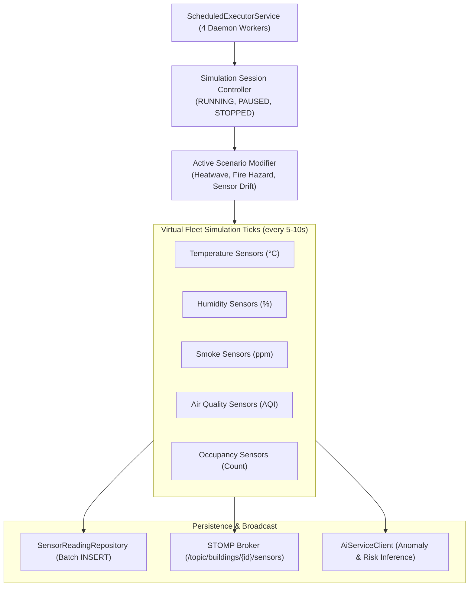

# NEXORA — Sensor Simulation & Dynamic Evacuation Routing

**System:** NEXORA — Edge-AI-Based Smart Building Safety and Occupancy Digital Twin System  
**Modules:** IoT Sensor Simulation Engine & Weighted Dijkstra Pathfinding

---

## 1. Virtual IoT Fleet Simulation Engine

### 1.1 Architectural Pattern
The simulation engine runs within the Java 21 Spring Boot core using a high-throughput, non-blocking `ScheduledExecutorService` (`SimulationEngineServiceImpl`). It manages independent concurrent simulation sessions across registered buildings without physical hardware:



### 1.2 Five Sensor Categories & Physical Physics Modeling
1. **Temperature (°C):**
   - *Baseline:* $22.5^\circ\text{C}$ with Gaussian diurnal variance ($\pm 1.2^\circ\text{C}$).
   - *Normal Drift:* Mean-reverting Ornstein-Uhlenbeck random walk.
2. **Humidity (%):**
   - *Baseline:* $45.0\%$ with negative correlation to high heat.
   - *Range:* $20.0\% - 75.0\%$.
3. **Smoke Concentration (ppm):**
   - *Baseline:* Clean indoor air $0.01 - 0.08\text{ ppm}$.
   - *Hazard Threshold:* $\ge 1.5\text{ ppm}$ indicates combustion particulate.
4. **Air Quality Index (AQI):**
   - *Baseline:* $25 - 45$ (Good).
   - *Hazard Threshold:* $\ge 150$ (Unhealthy for sensitive groups); $\ge 300$ (Hazardous).
5. **Occupancy (Count):**
   - *Baseline:* Integer count constrained between $0$ and room `maximumCapacity`.
   - *Diurnal Curve:* Peaks during business hours (09:00 - 17:00), low overnight.

### 1.3 Simulation Scenarios Catalog
Facility managers and safety officers can inject targeted stress scenarios:
- **`NORMAL_OPERATIONS`:** Nominal ambient drift, stochastic occupancy fluctuations.
- **`HEATWAVE_SPIKE`:** Temperatures elevate systematically to $34^\circ\text{C} - 42^\circ\text{C}$; humidity drops.
- **`SMOKE_EVENT` / `FIRE_HAZARD`:** Rapid exponential ramp in smoke concentration ($0.05 \to 35.0\text{ ppm}$) and temperature rise ($22^\circ\text{C} \to 78^\circ\text{C}$) in a designated room; triggers automatic incident creation.
- **`POOR_AIR_QUALITY`:** AQI elevates past 250 with particulate build-up.
- **`HIGH_OCCUPANCY`:** Occupancy surges to $95\% - 110\%$ of maximum capacity to simulate over-crowding drills.
- **`SENSOR_DEGRADATION`:** Introduces sensor noise, intermittent dropped packets, and baseline drift.

---

## 2. Dynamic Evacuation Routing Algorithm

### 2.1 Graph Representation
The building egress network is modeled as a directed graph $G = (V, E)$:
- **Vertices ($V$):** `EvacuationNode` objects representing:
  - `ROOM`: Centroid of occupant spaces.
  - `CORRIDOR`: Hallway navigation waypoints.
  - `STAIRCASE`: Vertical transition portals between floor levels.
  - `EMERGENCY_EXIT`: Exterior safe egress portals (North Plaza, East Fire Door).
- **Edges ($E$):** `EvacuationConnection` objects with length in meters, accessibility flags, and bidirectional support.

### 2.2 Weighted Dijkstra Pathfinding
To evacuate each room safely to the closest uncompromised emergency exit, the system executes an adapted Dijkstra shortest path algorithm:

```
Algorithm: Dynamic Hazard-Avoidance Dijkstra Egress
Input: Origin Room Node O, Target Exits {T}, Graph G(V, E), Danger Rooms {D}
Output: Optimal Safe Path P = [node_1, node_2, ..., exit_node]

1. Initialize distance array dist[v] = ∞ for all v in V, dist[O] = 0
2. PriorityQueue Q.insert((0, O))
3. While Q is not empty:
     u = Q.extractMin()
     If u in {T} and not u.isBlocked:
         bestExit = u; Break
     For each neighbor v of u via connection conn:
         If conn.isBlocked or not conn.isAccessible:
             Skip (Edge severed)
         If v is ROOM and v in {D} and v != O:
             Skip (Do not route through a burning/compromised room)
         
         weight = conn.distanceMeters
         If conn.hazardLevel == HIGH:
             weight = weight + 50.0   (Heavy detour penalty)
         Else If conn.hazardLevel == CRITICAL:
             Skip (Impassable hazard)
             
         If dist[u] + weight < dist[v]:
             dist[v] = dist[u] + weight
             prev[v] = u
             Q.insert((dist[v], v))
4. Reconstruct path from bestExit to O using prev pointers
5. Format path as 3D coordinate waypoints [[x, y, z], ...]
```

### 2.3 Dynamic Recalculation on Obstacles & Blockades
When safety officers toggle an evacuation corridor or stairwell as blocked (`POST /api/v1/evacuation/connections/{id}/toggle-block`), the backend:
1. Updates connection state `isBlocked = true`.
2. Triggers an immediate building-wide Dijkstra recomputation.
3. Automatically computes detours (e.g. routing occupants from Stairwell A across Level 2 to Stairwell B, and down to the East Fire Escape).
4. Emits updated 3D polyline waypoints over WebSocket topic `/topic/buildings/{id}/routes`.
5. Frontend 3D digital twin shifts glowing cyan vectors instantly.

---

## 3. Algorithm Boundaries & Limitations

1. **Crowd Congestion Dynamics:** The current algorithm computes shortest clear geometric distance with hazard penalties. It does not perform microscopic agent crowd-crush or bottleneck queuing simulations (e.g., Helbing’s Social Force Model).
2. **Graph Initialization:** Default graphs are auto-provisioned based on floor room coordinates. In complex irregularly shaped architectural blueprints, nodes must be registered to match exact corridor geometry.
3. **Simulated Emergency Context:** Path calculations are for academic demonstration and safety training drills. Real-world life-safety systems require hardwired NFPA-compliant egress annunciators and emergency lighting.

