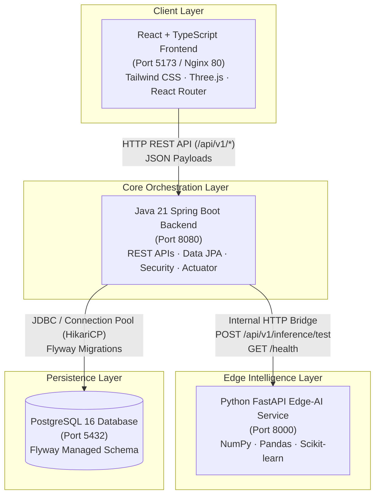
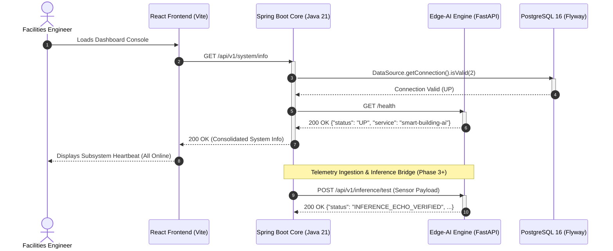

# System Architecture & Service Communication

## 1. High-Level Architectural Overview

The **Edge-AI-Based Smart Building Safety and Occupancy Digital Twin System** is designed as a modular monorepo consisting of three decoupled, independently deployable services and an isolated persistent database.

## 2. Strict Communication Rules Enforced
1. **Frontend Isolation**: The React frontend communicates strictly with the Java Spring Boot Backend over standard REST APIs (`/api/v1/*`). It never connects directly to the Python AI service or PostgreSQL.
2. **AI Service Isolation**: The Python AI Service is a pure stateless microservice. It does **NOT** access the PostgreSQL database. All state, configurations, and raw telemetry are managed and dispatched by the Java backend.
3. **Database Single Custodian**: PostgreSQL is exclusively accessed and mutated by the Java backend via Spring Data JPA and Flyway migrations.

## 3. Communication Sequence Flow

## 4. Subsystem Topology & Port Allocations
| Service | Technology | Internal Port | External Port | Role |
|---|---|---|---|---|
| **frontend** | React 18, TypeScript, Tailwind, Three.js | 80 / 5173 | 5173 | User visualization, 3D Digital Twin, Control Center |
| **backend** | Java 21, Spring Boot 3.3.5 | 8080 | 8080 | Orchestrator, Auth, Validation, Database custodian |
| **ai-service**| Python 3.11+, FastAPI, Uvicorn | 8000 | 8000 | Anomaly detection, Occupancy predictions |
| **postgres**  | PostgreSQL 16 Alpine | 5432 | 5432 | Relational system of record, migration store |
