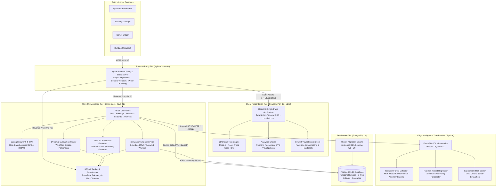
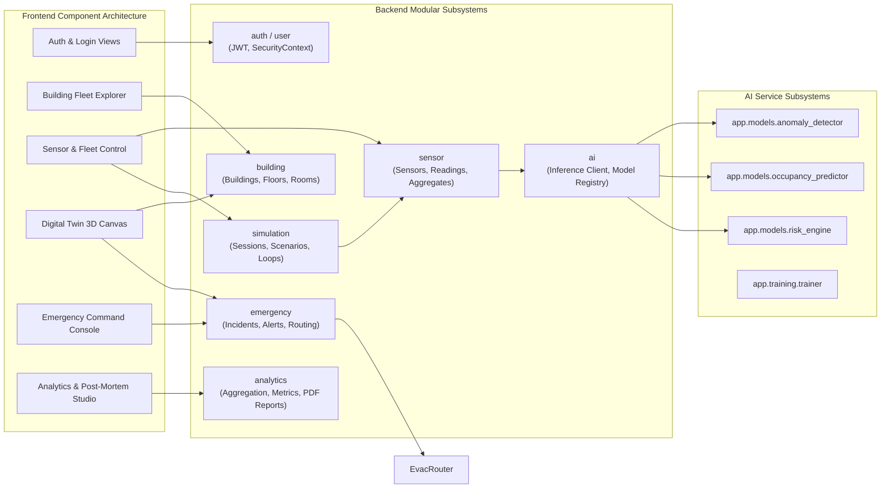
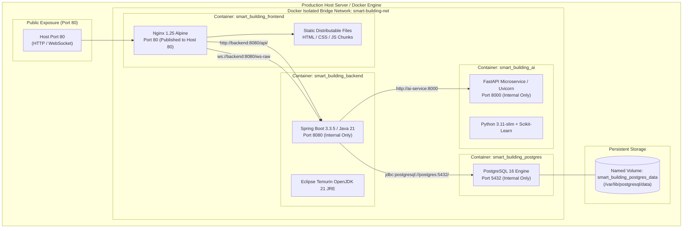

# NEXORA — System Architecture & Technical Specifications

**Product Name:** NEXORA  
**Tagline:** Intelligence Beyond Infrastructure.  
**System:** Edge-AI-Based Smart Building Safety and Occupancy Digital Twin System  
**Version:** 2.0 (Phase 9 - Final Deployment)

---

## 1. Project Overview & Objectives

NEXORA is a comprehensive smart building intelligence platform designed to bridge physical building infrastructure, edge machine learning, dynamic spatial twins, and automated emergency evacuation. It synthesizes IoT telemetry, performs low-latency anomaly detection and occupancy forecasting, renders real-time 3D interactive building models, and coordinates life-safety incident response.

### Core Objectives:
1. **IoT Fleet Simulation:** Ingest high-frequency telemetry from five virtual environmental and spatial sensor categories (Temperature, Humidity, Smoke, Air Quality, Occupancy).
2. **Edge AI Intelligence:** Execute real-time machine learning inference for anomaly detection (Isolation Forest), 15-minute predictive occupancy forecasting (Random Forest), and multi-criteria explainable room risk assessment.
3. **Interactive 3D Digital Twin:** Render real-time spatial topologies using Three.js and React Three Fiber, providing interactive floor explosion, heatmaps, and hazard overlays.
4. **Dynamic Emergency Egress:** Compute optimal evacuation routes using weighted Dijkstra pathfinding across corridors and stairwells, dynamically rerouting around compromised rooms and physical blockades.
5. **Operational Analytics & Reporting:** Track historical telemetry, generate automated incident post-mortem retrospectives, and export executive-ready PDF management reports.

---

## 2. Problem Statement & Proposed Solution

### The Problem
Modern commercial and institutional buildings face critical operational and safety challenges:
- **Siloed Building Management Systems (BMS):** HVAC, access control, fire detection, and safety systems operate in disconnected silos without unified telemetry.
- **Reactive Safety Protocols:** Evacuation protocols rely on static exit signs, leading occupants directly into smoke plumes or hazardous zones during dynamic fire incidents.
- **Underutilized Real Estate:** Facility managers lack predictive occupancy insights to optimize energy usage, zone conditioning, and spatial allocation.
- **High Deployment Costs:** Physical IoT deployment at scale is cost-prohibitive for rapid prototyping, safety drills, and research evaluation.

### The Proposed Solution
NEXORA delivers a software-only, modular, full-stack digital twin platform:
- **Simulated IoT Fleet:** Software-driven simulation generating physically grounded sensor values with controllable scenarios (e.g., Fire Hazard, Spike, Degradation).
- **Decoupled Edge AI:** Microservice architecture running local scikit-learn models for millisecond-scale inference without cloud latency.
- **Web-Based 3D Digital Twin:** Browser-native WebGL rendering accessible on any device without heavyweight CAD workstations.
- **Dynamic Egress Engine:** Real-time graph routing that detects emergencies, applies safety penalties, and publishes clear evacuation paths via WebSockets.

---

## 3. High-Level Architecture (C4 Model)

---

## 4. Component Diagram

---

## 5. Deployment Topology Diagram

---

## 6. Architecture Decision Records (ADRs)

### ADR-01: Monorepo Multi-Tier Decoupling
- **Status:** Accepted
- **Context:** The system requires frontend visualization, enterprise business orchestration, low-latency machine learning inference, and relational persistence.
- **Decision:** Maintain a clean polyglot monorepo containing:
  - `frontend/`: React 18, TypeScript, Tailwind CSS, Vite.
  - `backend/`: Java 21, Spring Boot 3.3.5.
  - `ai-engine/`: Python 3.11, FastAPI, Scikit-learn.
  - `database/`: PostgreSQL 16 with Flyway versioned migrations.
- **Consequences:** Eliminates code duplication, allows single-command Docker deployment, while maintaining strict protocol isolation.

### ADR-02: Java Backend as Single Database Custodian
- **Status:** Accepted
- **Context:** Preventing concurrent schema mutations and maintaining transaction boundaries.
- **Decision:** The Python AI service is completely stateless and has no direct database credentials. The Java backend manages all persistence, transactions, and entity relationships.
- **Consequences:** Ensures 100% schema consistency and prevents distributed locking bottlenecks.

### ADR-03: Local Scikit-Learn Inference over External LLM APIs
- **Status:** Accepted
- **Context:** Building life-safety and environmental monitoring requires sub-50ms deterministic inference without cloud API billing, rate limits, or network downtime risks.
- **Decision:** Deploy calibrated Isolation Forest and Random Forest models locally via FastAPI.
- **Consequences:** Zero external API dependencies, zero operational SaaS costs, high throughput, and reliable air-gapped performance.

### ADR-04: Declarative WebGL Digital Twin via React Three Fiber
- **Status:** Accepted
- **Context:** 3D building visualization must run in standard modern web browsers on mobile, tablet, and desktop without requiring native CAD software.
- **Decision:** Use Three.js wrapped with `@react-three/fiber` and `@react-three/drei`.
- **Consequences:** Reactive state binding directly maps building telemetry to mesh colors, elevations, and camera viewports with automatic GPU disposal.

### ADR-05: In-Memory Dijkstra Pathfinding with Dynamic Hazard Weighting
- **Status:** Accepted
- **Context:** Evacuation egress calculation during active emergencies must dynamically route occupants away from fire/smoke while accommodating blocked corridors.
- **Decision:** Build an in-memory adjacency graph initialized from building topologies, applying heavy distance penalties (+50m) for High Hazard areas and completely severing Critical or physically blocked edges.
- **Consequences:** Sub-millisecond calculation across multi-story buildings, dynamic recalculation on hazard status changes, and instant route broadcasting over WebSockets.
