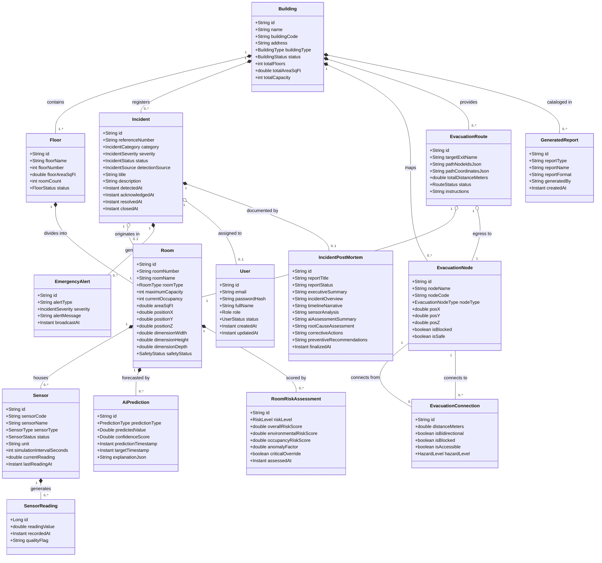
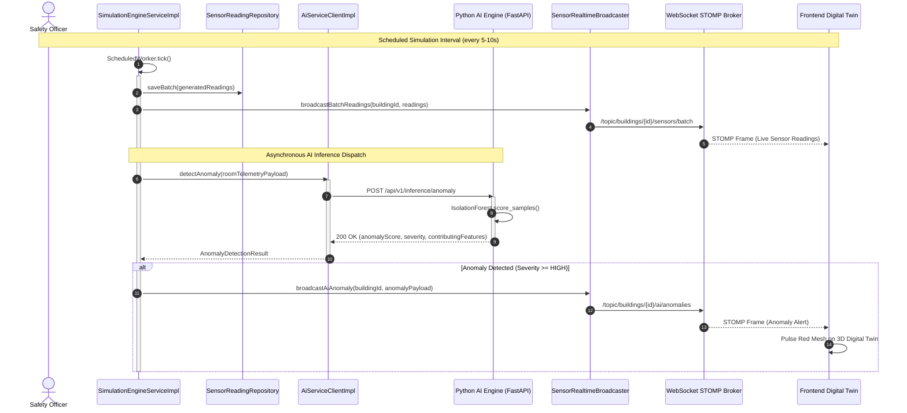
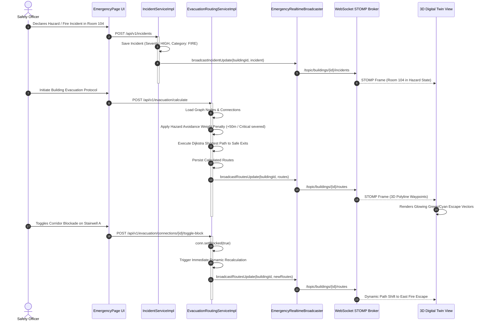
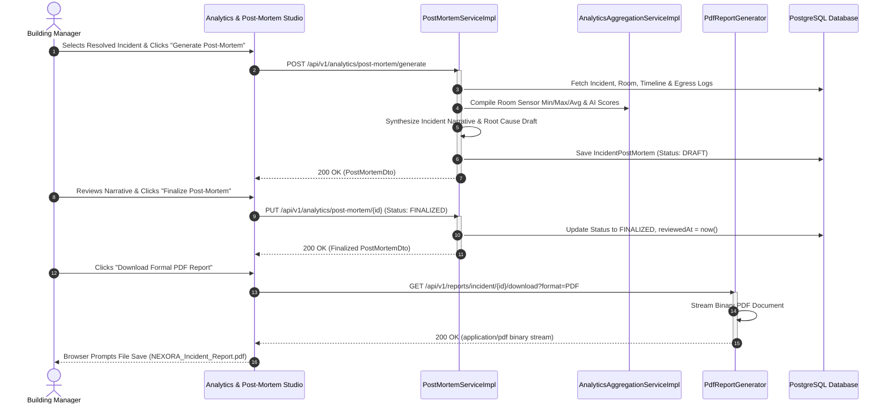
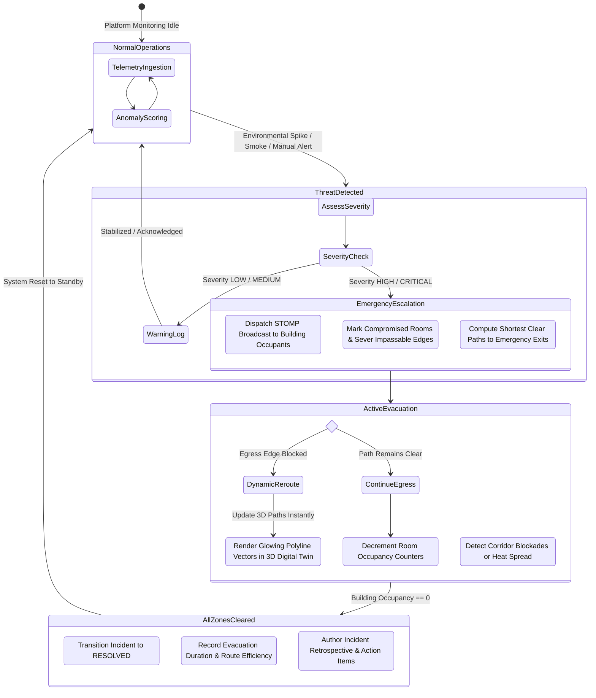

# NEXORA — Unified Modeling Language (UML) Specifications

**System:** NEXORA — Edge-AI-Based Smart Building Safety and Occupancy Digital Twin System  
**Document:** Object-Oriented Analysis and Design (OOAD) UML Models  
**Specification Level:** Implementation-Grounded (Reflects Active Phases 1 - 8 Codebase)

---

## 1. UML Use Case Diagram

```mermaid
flowchart LR
    %% Actors
    Admin(["System Administrator"])
    Manager(["Building Manager"])
    Safety(["Safety Officer"])
    Occupant(["Building Occupant"])

    subgraph NEXORASystem ["NEXORA Platform Scope"]
        subgraph AuthScope ["Authentication & Administration"]
            UC1["Authenticate Session\n(JWT Login / Register)"]
            UC2["Manage Users & Roles\n(RBAC Provisioning)"]
            UC3["Configure Building Fleet\n(Buildings, Floors, Rooms)"]
        end

        subgraph TelemetryScope ["IoT Simulation & Telemetry"]
            UC4["Manage Virtual Sensors\n(Create / Configure Sensors)"]
            UC5["Execute Simulation Sessions\n(Run / Pause / Stop Scenarios)"]
            UC6["Inspect Live Readings\n(Telemetry Graphs & Stats)"]
        end

        subgraph AiScope ["Edge AI Intelligence"]
            UC7["Monitor Multi-Modal Anomalies\n(Isolation Forest Inference)"]
            UC8["View Occupancy Forecasts\n(15-Minute ML Predictions)"]
            UC9["Evaluate Room Safety Risks\n(Explainable Threat Scores)"]
            UC10["Calibrate / Retrain Models\n(Trigger Synthetic Calibration)"]
        end

        subgraph TwinScope ["3D Digital Twin"]
            UC11["Interact with 3D Twin\n(Orbit, Explode, Wireframe)"]
            UC12["Inspect Room State\n(Telemetry & Risk Heatmaps)"]
        end

        subgraph EmergencyScope ["Emergency & Evacuation"]
            UC13["Declare Emergency Incident\n(Manual or AI-Triggered)"]
            UC14["Compute Evacuation Routes\n(Weighted Dijkstra Pathfinding)"]
            UC15["Toggle Corridor Blockades\n(Simulate Obstacles & Reroute)"]
            UC16["Track Evacuation Clearance\n(Room Occupancy Depletion)"]
        end

        subgraph AnalyticsScope ["Analytics & Post-Mortem"]
            UC17["Query Telemetry Trends\n(Historical Heatmaps & Bars)"]
            UC18["Author Incident Post-Mortem\n(Draft, Review, Finalize)"]
            UC19["Download Executive PDF Report\n(Incident / Fleet Reports)"]
        end
    end

    %% Administrator Associations
    Admin --> UC1
    Admin --> UC2
    Admin --> UC3
    Admin --> UC4
    Admin --> UC5
    Admin --> UC10
    Admin --> UC18
    Admin --> UC19

    %% Building Manager Associations
    Manager --> UC1
    Manager --> UC3
    Manager --> UC4
    Manager --> UC5
    Manager --> UC6
    Manager --> UC8
    Manager --> UC11
    Manager --> UC17
    Manager --> UC19

    %% Safety Officer Associations
    Safety --> UC1
    Safety --> UC6
    Safety --> UC7
    Safety --> UC9
    Safety --> UC11
    Safety --> UC12
    Safety --> UC13
    Safety --> UC14
    Safety --> UC15
    Safety --> UC16
    Safety --> UC18
    Safety --> UC19

    %% Occupant Associations
    Occupant --> UC1
    Occupant --> UC11
    Occupant --> UC14
```

---

## 2. UML Domain Class Diagram

---

## 3. Sequence Diagram 1: Virtual IoT Fleet Telemetry & Edge AI Anomaly Loop

---

## 4. Sequence Diagram 2: Emergency Detection, Weighted Dijkstra Egress & Corridor Reroute

---

## 5. Sequence Diagram 3: Incident Post-Mortem & PDF Executive Report Generation

---

## 6. UML Activity Diagram: Emergency Evacuation Lifecycle

